# Labs

A self-hosted inventory dashboard for a shared research lab. It keeps one list of
what the lab owns (chemicals, consumables, instruments), records who used or
borrowed what, and warns before a chemical expires or a shelf runs empty.

It runs as a single Docker container, serves one lab or several isolated labs from
the same process, and needs nothing else: no Redis, no second image for backups, no
cron container.

<picture>
  <source media="(prefers-color-scheme: dark)" srcset="docs/architecture-dark.svg">
  
</picture>

A request starts in the React SPA, reaches Hono through the Cloudflare Tunnel, and
carries a lab id (header, query parameter or cookie). The guard loads the session and
that role's permission set, the route handler runs against the lab's own Drizzle
instance, and SQLite reads the matching file. Backups are written by the same process
with `VACUUM INTO`.

The diagram is Mermaid source in [`docs/architecture.mmd`](docs/architecture.mmd),
rendered to SVG by [Pele](https://pele.run) with CSS variable theming. Rebuild both
themes after editing it:

```bash
npm run docs:diagram
```

## What it does

| Area | What you get |
|---|---|
| **Inventory** | Items with category, quantity and unit, storage location, low-stock threshold, optional image URL. Search, category filter, pagination, CSV export. |
| **Chemicals** | CAS number, molecular formula, GHS hazard class and pictogram codes, expiry date, storage conditions, SDS link. Chemicals that expire within the next 60 days surface on the dashboard. |
| **Equipment** | Serial number, condition and purchase date. Check out with an expected return date, return it, see overdue items, and reserve an instrument for a future slot. |
| **Usage** | Log consumption against an item with a note. The quantity drops, and the entry stays in the item's usage history. |
| **Roles** | Six roles: Admin, Supervisor, PostDoc, PhD, Project Research Fellow, Others. Each role's permission set is stored in the database and edited on the Permissions page. Accounts are created by an Admin or Supervisor; public sign-up is closed. |
| **Notifications** | Low stock, expiring chemicals and overdue equipment. Generate them on a schedule or on demand. |
| **Audit log** | Every create, update, delete, checkout, return and login, with actor, entity, timestamp and IP. Paged, with a CSV export. |
| **Labs** | Each extra lab gets its own database file and its own users, inventory and history. Create one from Administration → Labs, or from environment variables. |

## Screenshots

The dashboard: totals, low-stock and expiry warnings, usage and checkout charts, and
the lists that need attention. It follows the theme you pick in the header.

<picture>
  <source media="(prefers-color-scheme: dark)" srcset="screenshots/dashboard-dark.png">
  
</picture>

Inventory: quantity, unit, location and status in one table, with filters and CSV
export above it.

<picture>
  <source media="(prefers-color-scheme: dark)" srcset="screenshots/inventory-dark.png">
  
</picture>

An item page keeps the stock level, the chemical safety block (CAS, GHS class,
expiry, storage, SDS) and the full usage history together.


Equipment: checkout and return, the expected return date, and upcoming bookings with
the person and the purpose.


Audit log: who changed what, newest first, with the actor and a short note for each
entry.


Labs: the current lab, and a form for creating another one. The new lab starts with
default categories and permissions, and your Admin account is copied into it.


Usage log and the permission matrix:

| | |
|---|---|
|  |  |
| Logged consumption, newest first. | One checkbox per permission and role. |

On a phone the tables keep their columns inside the viewport and the sidebar moves
into a sheet.

| | |
|---|---|
|  |  |

Screenshots come from a demo database; names and quantities are sample data.

## Run it locally

```bash
npm install
cp .env.example .env       # set DATABASE_URL, BETTER_AUTH_URL, BETTER_AUTH_SECRET
npm run db:setup           # generate, migrate and seed
npm run dev                # Vite on :5173, API on :3000
```

`npm run db:seed` prints the generated Admin password once. Set
`SEED_ADMIN_PASSWORD` to choose it yourself. The seeded account is `admin@lab.edu`,
or `admin` once the username backfill has run.

Run the checks that CI runs:

```bash
npx tsc --noEmit
npm test
npm run build
npm run build:server
```

The API tests call the real Hono app through `app.request` against a throwaway SQLite
file, so no dev server is needed. They cover pagination and count semantics, the
checkout race, stock that cannot go negative, deletes that hit foreign keys, the
last-admin guard and role-change auditing. The migration test fails when a new
`drizzle/*.sql` file is missing from `drizzle/meta/_journal.json` or when a migration
has an empty statement chunk.

## Deploy with Docker

Set the two required values and start the stack:

```bash
export BETTER_AUTH_SECRET=$(openssl rand -base64 32)
export BETTER_AUTH_URL=https://labs.example.com
docker compose up -d
```

The container listens on port 3000 and serves the built SPA and the API from the same
origin. Point a Cloudflare Tunnel at `http://localhost:3000`, or put it behind any
reverse proxy that terminates TLS.

The image is a three-stage build on `node:20-alpine`. It runs as the unprivileged
`node` user (uid 1000), applies migrations and the idempotent seed on every start,
and exposes `GET /api/health` for the Docker healthcheck. The server is bundled to
plain JavaScript with esbuild, so production runs on bare `node` with dev
dependencies removed.

`./data` and `./backups` are bind mounts and must be writable by uid 1000:

```bash
sudo chown -R 1000:1000 ./data ./backups
```

## Two or more labs in one instance

A lab is a database file. One process can serve several of them without sharing a
single row between them.

Create a lab in **Administration → Labs**: it gets a fresh database next to the
current one, the default categories and permissions, and a copy of your Admin
account (same email and password). Switch by logging out and picking the lab on the
login page. The registry lives in `labs.json` next to the database files, so labs
created this way survive restarts and redeploys.

Labs can also come from the environment, which keeps them fixed at deploy time:

```bash
DATABASE_URL=file:./data/lab1.db
LAB2_DATABASE_URL=file:./data/lab2.db
LAB1_NAME=Photonics Lab
LAB2_NAME=Quantum Lab

npm run db:migrate                 # migrates every configured lab
npm run db:seed                    # seeds lab 1
SEED_LAB=lab-2 npm run db:seed     # seeds lab 2 with the same admin credentials
```

The login page shows a lab selector only when a second lab is configured; with one
lab it stays hidden.

## Backups

Backups run inside the app process. Every hour the server checks the newest file in
`BACKUP_DIR` and, if it is older than `BACKUP_INTERVAL_HOURS`, copies each lab database
with SQLite's `VACUUM INTO`. That snapshots a live database consistently and compacts
the copy. Only the newest `BACKUP_KEEP` files per lab are kept.

Checking the files on disk instead of holding a timer is what keeps restarts and
redeploys from producing duplicate backups. A failed backup is logged and retried on
the next check; it does not stop the server.

| Variable | Default | Meaning |
|---|---|---|
| `BACKUP_ENABLED` | `1` | set `0` to turn in-process backups off |
| `BACKUP_DIR` | `./backups` | destination directory, must be writable |
| `BACKUP_INTERVAL_HOURS` | `24` | minimum age before a new backup is written |
| `BACKUP_KEEP` | `14` | files kept per lab |

To restore, stop the container, copy `backups/backup_<lab>_<timestamp>.db` over the
lab's database file, and start it again.

## Configuration

| Variable | Required | Purpose |
|---|---|---|
| `DATABASE_URL` | yes | libSQL URL of the primary database, usually `file:./data/lab.db` |
| `BETTER_AUTH_URL` | yes | public base URL, used for cookies, origin checks and reset links |
| `BETTER_AUTH_SECRET` | yes | signing secret for sessions |
| `TRUSTED_ORIGINS` | no | comma-separated extra origins for previews or alternate domains |
| `LAB2_DATABASE_URL`, `LAB1_NAME`, `LAB2_NAME` | no | second env-defined lab |
| `LAB_DATABASES` | no | JSON list of labs, for more than two |
| `LOG_RESET_LINKS` | no | set `1` to print password reset links to the server log |
| `BACKUP_*` | no | see the backup table above |
| `PORT` | no | defaults to 3000 |

## Development notes

```
src/
├── server/          Hono app, routes, middleware, Better Auth config
│   ├── db/          Drizzle schema, lab routing, migrations
│   ├── routes/      items, equipment, usage, audit, users, labs, export, ...
│   └── lib/         permissions, audit, notifications, backups, settings
├── pages/           React Router pages
├── components/      shadcn/ui primitives and app components
├── hooks/           TanStack Query hooks
└── lib/             API client, auth client, date formatting
scripts/
├── seed.ts          idempotent seed
├── generate-notifications.ts  cron entry point for scheduled alerts
└── render-architecture.mjs    Mermaid to SVG via Pele
docs/
├── architecture.mmd           diagram source
└── architecture.svg           rendered light and dark variants
```

Notifications can be generated by a cron job without the web server:

```bash
npx tsx scripts/generate-notifications.ts
```

The same work is available to admins as `POST /api/notifications/generate`.

## Security notes

These are the properties the code actually has, not a compliance claim.

- Self sign-up is rejected. Accounts are created by an Admin or Supervisor.
- Session cookies are httpOnly and SameSite=Lax; they are marked Secure when
  `BETTER_AUTH_URL` starts with `https://`.
- Every response carries `X-Content-Type-Options`, `X-Frame-Options: DENY`,
  `Referrer-Policy` and `Permissions-Policy`; HSTS is added over HTTPS.
- CORS allows credentials only from the listed origins, because the API depends on
  session cookies.
- CSV export quotes fields and prefixes values that start with `=`, `+`, `-` or `@`,
  which blocks spreadsheet formula injection.
- Password reset has no mail transport. The reset URL is printed to the server
  console when `LOG_RESET_LINKS=1` (or outside production), so anyone with log access
  can use it. Turn it off on a deployed instance and wire a mailer in
  `src/server/auth.ts`.
- Roles and permissions are data, so an Admin can lock a role out of a page by
  removing its permission. Keep at least one account with `permissions:manage`.

## License

MIT. See [LICENSE](LICENSE).
